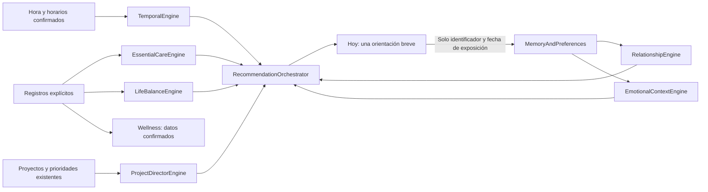

# Inteligencia cotidiana de Roadmap

La experiencia sigue siendo Hoy, Proyectos y Wellness, con preferencias opcionales en Más. No se añadió un servicio de IA, conexión con ChatGPT, lectura de conversaciones, calendario remoto ni notificaciones. Los ocho servicios funcionan localmente y reciben datos explícitos. El motor anterior de `day-director.js` permanece como base temporal y de rutina.

## Servicios

| Servicio | Responsabilidad y datos reales |
| --- | --- |
| `TemporalEngine` | Hora/zona local, día, horarios diarios y habituales, traslados, compromisos confirmados, margen y descanso configurado. Un horario desconocido permanece desconocido. |
| `EssentialCareEngine` | Candidatas agrupadas de higiene/agua, desayuno, comida, cena, movimiento, recuperación e higiene nocturna. Lee confirmaciones; no las crea. |
| `RelationshipEngine` | Usa exclusivamente modo de contacto, fecha y frecuencia elegidos. Distancia, silencio, desactivación y silencio global excluyen contacto. Sin fecha/frecuencia no hay un recordatorio individual. |
| `EmotionalContextEngine` | Acompañamiento calmado de madrugada solo si se declaró voluntariamente ese patrón. No diagnostica ni activa un perfil por la hora. Un turno real prevalece. |
| `ProjectDirectorEngine` | Usa la prioridad existente, la siguiente actividad, estados/avance y dependencias cuando están documentados. Considera fechas límite registradas sin reordenar arbitrariamente los proyectos. |
| `LifeBalanceEngine` | Ventanas de siete y treinta días sobre confirmaciones diarias y actividades declaradas. La ausencia de registros no es falta de autocuidado. Los compromisos económicos se consideran solo con una fecha registrada. |
| `MemoryAndPreferences` | Valida preferencias, límites, registros, contexto importado con permiso e historial mínimo de exposición. Proporciona importación autorizada como interfaz técnica, sin conexión externa implementada. |
| `RecommendationOrchestrator` | Filtra, puntúa, desempata y selecciona una protagonista, hasta dos siguientes y una prioridad profesional. Produce una explicación reproducible sin datos íntimos. |

Los archivos están separados en `intelligence/`. `core.js` define el contrato común con JSDoc y validación de límites/tipos. `intelligence-ui.js` implementa los controles secundarios; el resto del frontend y el almacenamiento anterior se conservan.

## Selección verificable

Cada candidata tiene ID estable, dominio, título, mensaje, motivo, ventana, urgencia/importancia, evidencias, confianza, última visualización, enfriamiento, caducidad, exclusiones y horizonte. La confianza es una clasificación interna de la fuente, no una probabilidad clínica.

Orden de prioridad: compromisos configurados inminentes y recuperación; cuidados pertinentes; trabajo profesional y obligaciones con fecha; sugerencias opcionales. Las excepciones usan reglas explícitas. El modo calmado nocturno requiere una declaración voluntaria. Las notas relacionales no se interpretan con NLP: los límites efectivos son los controles de contacto que el usuario elige.

La puntuación es `tier*10000 + urgency*50 + importance*8 + confidence*20 - recency - saturation`. Los desempates utilizan el ID estable. Un mismo contexto conserva su sugerencia hasta quince minutos si sigue siendo pertinente; un compromiso de nivel superior puede interrumpir esa continuidad. Los datos nuevos, límites, caducidad o cambios de franja también la invalidan.

Las recomendaciones opcionales de vínculos, equilibrio y planificación respetan un enfriamiento estricto. Se toma el mayor entre la pausa de la candidata y la preferencia general. Tres exposiciones opcionales consecutivas del mismo dominio lo excluyen temporalmente para evitar monopolio. Los cuidados y compromisos urgentes se protegen de esa penalización para que la variedad no desplace lo esencial. Los siguientes pasos también pasan validación de silencio y pertinencia. No hay rotación aleatoria.

La evaluación devuelve motivos, puntuaciones y códigos de exclusión para pruebas y depuración. La interfaz secundaria muestra solo el motivo de la seleccionada. Los nombres, notas privadas, importes y referencias personales no se copian a esa explicación ni a Hoy.

## Memoria y privacidad

Se mantienen dos espacios locales:

- `mi-tablero-personal-v1`: datos anteriores, proyectos, notas, marcas, horarios y respaldos existentes.
- `roadmap-intelligence-v1`: nuevas preferencias y contexto del asistente. No se incluye en el respaldo habitual de proyectos; tiene exportación/importación separada y explícita.

El esquema distingue `confirmed`, `patterns` declarados, `relationships`, `records`, `obligations`, `imported`, `hypotheses` y `exposure`. La información desconocida utiliza `null` o ausencia, no ceros de comportamiento. `hypotheses` permanece vacío: no se genera ni persiste un perfil psicológico. Las sugerencias son transitorias, no registros de realización.

Los perfiles relacionales comienzan vacíos. No se precarga una persona ni información de esta conversación. Un vínculo nuevo empieza sin sugerencias hasta que el usuario lo permita. Alias y contexto privado se insertan en el DOM solo mientras se abre expresamente ese panel; al cerrarlo o salir de Más se retiran. Hoy utiliza mensajes genéricos, aunque una frecuencia personal haya motivado la sugerencia.

La memoria puede editarse, exportarse, importarse con confirmación y eliminarse. La eliminación del asistente no borra proyectos ni marcas originales. Un archivo inválido no sustituye datos; una memoria que no se pueda leer no se sobrescribe automáticamente. Los fallos de escritura explícitos conservan la versión anterior y muestran error. Las actualizaciones de exposición en otra pestaña no interrumpen un formulario privado en edición.

El almacenamiento es del navegador y del origen web: **no está cifrado ni protegido frente a otras personas con acceso al mismo perfil o scripts del mismo origen**. No hay backend ni autenticación nueva, y no se afirma que existan. El contexto no sale de la aplicación, salvo que el usuario descargue/comparta su archivo. No se escriben valores personales en logs, repositorio, notificaciones o servicios externos.

El historial automático contiene únicamente ID, dominio y fecha de una sugerencia visible; su secuencia se recorta a 200 entradas y treinta días al registrar una nueva exposición. El índice para enfriamientos largos conserva como máximo 500 identificadores y un año, también sin contenido personal. No almacena el texto privado, no mide uso productivo y no alimenta Wellness ni equilibrio como si fuera una actividad realizada. No se escribe cada minuto si la sugerencia no cambió; la página oculta no recalcula ni registra exposición.

## Evidencia y bienestar

Solo registros confirmados y con fecha sustentan tendencias. Las marcas anteriores con precisión de día conservan esa precisión: no se inventa una hora. Los datos sin fecha no se fechan retrospectivamente.

Para sugerir una pausa por carga registrada se requieren al menos tres días con bloques profesionales declarados de dos horas o más y un total de descanso explícitamente declarado inferior a treinta minutos. La ausencia de descanso registrado por sí sola no cumple la regla. Los bloques idénticos se deduplican para el análisis y se distinguen los bloques de los totales diarios. No se puntúa el valor personal ni se diagnostica desequilibrio.

Los nuevos registros voluntarios de comida, movimiento y descanso pueden alimentar una vista derivada de Wellness, sin reescribir las marcas originales ni sustituir una corrección explícita. Una cena se incorpora a su conteo solo si existe ese registro. Las recomendaciones, programaciones y exposiciones nunca se convierten en confirmaciones. No se admiten realizaciones futuras como si ya hubieran ocurrido.

## Verificación y límites

`roadmap-intelligence.cjs` comprueba los ocho servicios, los escenarios de las 10:00, 13:30, 17:00, 21:30 y 02:00, domingo, límites personales, datos desconocidos, ausencia de proyectos, carga confirmada, vencimientos, competencia, desempate, enfriamiento, saturación, expiración y permiso de importación.

`roadmap-intelligence-browser.cjs` comprueba edición privada, consentimiento, ausencia de detalles privados en Hoy/DOM cerrado, registros reales, corrección/eliminación, exportación, importación, aislamiento del almacenamiento, escrituras fallidas, memoria corrupta, responsive y accesibilidad. También se ejecutan las suites anteriores de datos, motor contextual y navegador completo para proteger Proyectos, Wellness, respaldos, nueve anchos y ampliación al 200%.

Las pruebas usan relojes simulados y datos sintéticos en perfiles aislados. No prueban un iPhone físico ni certifican atención clínica. No se integran conversaciones ni memoria de ChatGPT; la importación técnica acepta exclusivamente el formato de memoria validado y consentimiento explícito. No hay avisos ni notificaciones en segundo plano.

Referencia recuperable anterior: `backup/pre-intelligence-20261108`, commit `d3423f5a2312ee7a22cef6dca77c0265afde9d84`, y bundle fuera del checkout. Las fórmulas y valores iniciales de Proyectos se mantienen.
